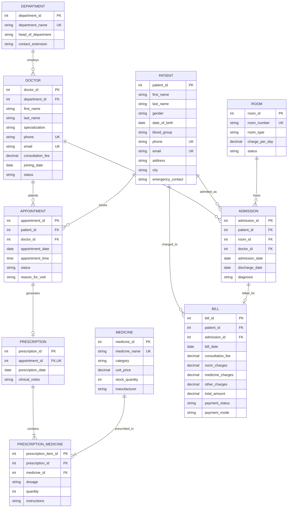

# HOSPITAL MANAGEMENT SYSTEM (HMS)
## Database Management Systems Project & Comprehensive Viva Guide
**Academic Level:** Third-Year Bachelor of Engineering (Computer Engineering / Information Technology)  
**RDBMS Platform:** MySQL 8.0+  
**Storage Engine:** InnoDB (ACID-compliant, Foreign Key Support, Row-level Locking)

---

## 1. Project Overview & Abstract

The **Hospital Management System (HMS)** is a relational database project designed to streamline and automate the clinical, administrative, and financial workflows of a modern multi-specialty hospital. The system eliminates manual record-keeping bottlenecks, enforces strict data consistency, prevents operational conflicts (such as doctor double-booking or bed over-allocation), and provides real-time reporting for hospital administrators.

### Core Objectives
1. **Clinical Efficiency:** Centralize patient demographics, doctor specializations, outpatient consultations, and inpatient admissions.
2. **Automated Business Rules via Triggers:** Enforce strict business logic at the database layer (preventing future DOB entry, auto-toggling room occupancy, real-time stock deduction, automated bill compilation, and preventing doctor schedule collisions).
3. **Data Integrity & Normalization:** Model all relations up to **Third Normal Form (3NF)** with primary keys, foreign keys, cascade rules, and check constraints.
4. **Actionable Financial & Operational Insights:** Provide analytical SQL queries, views, and stored procedures for bed availability, pharmacy stock reordering, departmental workloads, and billing revenue.

---

## 2. System Architecture & Modules

The database contains **10 relational tables** structured into 8 distinct hospital modules:

```
+-----------------------------------------------------------------------------------+
|                        HOSPITAL MANAGEMENT SYSTEM (HMS)                           |
+-----------------------------------------------------------------------------------+
  │
  ├── 1. Department Management (Clinical specialties & HOD administration)
  ├── 2. Doctor Management     (Doctor credentials, contact info, consultation fees)
  ├── 3. Patient Management    (Demographics, contact info, blood group, emergency)
  ├── 4. Appointment System    (Doctor-patient consultation schedules & time slots)
  ├── 5. Room & Bed Management (General wards, semi-private, deluxe, ICU capacity)
  ├── 6. Inpatient Admission   (Admission tracking, diagnosis, length of stay, discharge)
  ├── 7. Pharmacy Inventory    (Medicine catalog, unit pricing, real-time stock balance)
  ├── 8. Prescription Module   (Clinical notes, itemized dosages, instructions)
  └── 9. Invoicing & Billing   (Consolidated fees: doctor, room, pharmacy, auxiliary)
```

---

## 3. Entity-Relationship (ER) Diagram

The following Mermaid diagram illustrates the entities, primary keys, attributes, and cardinality relationships across the entire database:



---

## 4. Relational Database Schema & Data Dictionary

| Table Name | Primary Key | Foreign Key(s) | Key Constraints | Purpose |
| :--- | :--- | :--- | :--- | :--- |
| **Department** | `department_id` | *None* | `UNIQUE(department_name)` | Tracks medical departments & HODs |
| **Doctor** | `doctor_id` | `department_id` → Department | `UNIQUE(phone, email)`, `CHECK(fee >= 0)` | Stores doctor profiles & consultation rates |
| **Patient** | `patient_id` | *None* | `UNIQUE(phone)`, `CHECK(blood_group IN ...)` | Master table for patient demographics |
| **Appointment** | `appointment_id` | `patient_id` → Patient<br>`doctor_id` → Doctor | `ENUM(status)`, `ON DELETE CASCADE` (Patient) | Manages consultation bookings |
| **Room** | `room_id` | *None* | `UNIQUE(room_number)`, `CHECK(charge > 0)` | Master list of beds/rooms with types |
| **Admission** | `admission_id` | `patient_id` → Patient<br>`room_id` → Room<br>`doctor_id` → Doctor | `CHECK(discharge_date >= admission_date)` | Inpatient stay lifecycle and diagnosis |
| **Medicine** | `medicine_id` | *None* | `UNIQUE(medicine_name)`, `CHECK(stock >= 0)` | Pharmacy inventory and unit pricing |
| **Prescription** | `prescription_id`| `appointment_id` → Appointment | `UNIQUE(appointment_id)` (1:1 with consult) | Doctor's consultation diagnosis & notes |
| **Prescription_Medicine** | `prescription_item_id` | `prescription_id` → Prescription<br>`medicine_id` → Medicine | `UNIQUE(prescription_id, medicine_id)` | Associative bridge table resolving M:N |
| **Bill** | `bill_id` | `patient_id` → Patient<br>`admission_id` → Admission | `CHECK(total >= 0)`, `ON DELETE SET NULL` | Consolidated invoice and payment tracking |

---

## 5. Database Normalization (1NF, 2NF, 3NF Analysis)

During project evaluation, examiners frequently ask students to justify why their database is normalized. Here is the formal justification:

### First Normal Form (1NF)
- **Rule:** Every column contains atomic (indivisible) values. There are no repeating groups or comma-separated lists.
- **Project Application:**
  - In `Patient`, names are separated into `first_name` and `last_name`.
  - In `Prescription`, multiple medicines are **not** stored as a comma-separated string (e.g. `"Paracetamol, Atorvastatin"`). Instead, each medicine is separated into individual atomic rows in the bridge table `Prescription_Medicine`.
  - Every table has a clearly designated Primary Key.

### Second Normal Form (2NF)
- **Rule:** The relation must be in 1NF, and all non-key attributes must be fully functionally dependent on the primary key (no partial dependency on part of a composite key).
- **Project Application:**
  - In `Prescription_Medicine`, composite attributes `(prescription_id, medicine_id)` are backed by a single surrogate primary key `prescription_item_id`.
  - Attributes such as `dosage`, `quantity`, and `instructions` depend on the **entire** combination of prescription and medicine, not on one alone.
  - Attributes specific to medicines (such as `unit_price`, `manufacturer`) reside exclusively in `Medicine`, eliminating partial dependencies.

### Third Normal Form (3NF)
- **Rule:** The relation must be in 2NF, and no non-key attribute is transitively dependent on the primary key ($X \rightarrow Y$ and $Y \rightarrow Z$, where $Z$ depends on $X$ through $Y$).
- **Project Application:**
  - In `Doctor`, department details such as `head_of_department` and `contact_extension` are **not** stored. If they were, changing the HOD would cause update anomalies. Instead, `Doctor` references `department_id`, and all department metadata resides strictly in `Department`.
  - In `Appointment`, doctor phone and email are not replicated. The relation holds only `doctor_id`.
  - In `Admission`, room daily charge is not replicated; only `room_id` is referenced.

---

## 6. Comprehensive Trigger Documentation & Demonstration

Triggers are active rules executed automatically by the MySQL engine when specific events (`INSERT`, `UPDATE`, `DELETE`) occur.

### Summary Table of All 6 Triggers
| # | Trigger Name | Table | Event & Timing | Purpose |
| :- | :--- | :--- | :--- | :--- |
| **T1** | `trg_prevent_future_dob` | `Patient` | `BEFORE INSERT` | Rejects any patient record where date of birth is in the future |
| **T2** | `trg_room_occupied_on_admission` | `Admission`| `AFTER INSERT` | Toggles Room status to `'Occupied'` when patient is admitted |
| **T3** | `trg_room_available_on_discharge` | `Admission`| `AFTER UPDATE` | Frees Room back to `'Available'` when discharge date is recorded |
| **T4** | `trg_prevent_doctor_double_booking` | `Appointment`| `BEFORE INSERT` | Prevents booking a doctor twice on identical date and time slot |
| **T5** | `trg_calculate_total_bill_insert` | `Bill` | `BEFORE INSERT` | Computes `total_amount = consultation + room + medicine + other` |
| **T6** | `trg_deduct_medicine_stock` (Bonus) | `Prescription_Medicine` | `AFTER INSERT` | Deducts prescribed quantities directly from pharmacy inventory |

---

### Deep Dive: Each Trigger with Verification Code & Explanation

#### TRIGGER 1: Prevent Invalid Future Date of Birth
* **Trigger Name:** `trg_prevent_future_dob`
* **Purpose:** Clinical validation to ensure no newborn or patient is erroneously entered with a future calendar birth date.
* **SQL DDL:**
  ```sql
  DELIMITER $$
  CREATE TRIGGER trg_prevent_future_dob
  BEFORE INSERT ON Patient
  FOR EACH ROW
  BEGIN
      IF NEW.date_of_birth > CURDATE() THEN
          SIGNAL SQLSTATE '45000'
          SET MESSAGE_TEXT = 'Validation Error: Patient Date of Birth cannot be in the future!';
      END IF;
  END$$
  DELIMITER ;
  ```
* **Test Statement (Negative Test Case):**
  ```sql
  INSERT INTO Patient (
      first_name, last_name, gender, date_of_birth, blood_group, 
      phone, email, address, city, emergency_contact
  ) VALUES (
      'Baby', 'Sharma', 'Male', '2030-01-01', 'O+', 
      '9999888877', 'baby.sharma@gmail.com', 'Andheri East', 'Mumbai', '9999888878'
  );
  ```
* **Expected Output:**
  ```
  ERROR 1644 (45000): Validation Error: Patient Date of Birth cannot be in the future!
  ```
* **Explanation:** The `BEFORE INSERT` trigger inspects the row values before writing to disk. When `NEW.date_of_birth > CURDATE()`, `SIGNAL SQLSTATE '45000'` halts execution and rolls back the operation.

---

#### TRIGGER 2: Automatically Mark Room as Occupied upon Admission
* **Trigger Name:** `trg_room_occupied_on_admission`
* **Purpose:** Real-time bed occupancy synchronization without relying on front-end code.
* **SQL DDL:**
  ```sql
  DELIMITER $$
  CREATE TRIGGER trg_room_occupied_on_admission
  AFTER INSERT ON Admission
  FOR EACH ROW
  BEGIN
      IF NEW.discharge_date IS NULL THEN
          UPDATE Room
          SET status = 'Occupied'
          WHERE room_id = NEW.room_id;
      END IF;
  END$$
  DELIMITER ;
  ```
* **Test Statement:**
  ```sql
  -- Before test: Room 2 ('GW-102') is 'Available'
  INSERT INTO Admission (patient_id, room_id, doctor_id, admission_date, discharge_date, diagnosis)
  VALUES (10, 2, 5, CURDATE(), NULL, 'Viral Pyrexia with Dehydration');

  -- Verify room status:
  SELECT room_id, room_number, status FROM Room WHERE room_id = 2;
  ```
* **Expected Output:**
  ```
  +---------+-------------+----------+
  | room_id | room_number | status   |
  +---------+-------------+----------+
  |       2 | GW-102      | Occupied |
  +---------+-------------+----------+
  ```
* **Explanation:** The `AFTER INSERT` trigger detects an active admission (`discharge_date IS NULL`) and fires an automated `UPDATE` on the corresponding row in `Room`, changing status from `'Available'` to `'Occupied'`.

---

#### TRIGGER 3: Automatically Free Room back to Available upon Discharge
* **Trigger Name:** `trg_room_available_on_discharge`
* **Purpose:** When a patient is discharged, immediately release the room back into hospital circulation.
* **SQL DDL:**
  ```sql
  DELIMITER $$
  CREATE TRIGGER trg_room_available_on_discharge
  AFTER UPDATE ON Admission
  FOR EACH ROW
  BEGIN
      IF (OLD.discharge_date IS NULL AND NEW.discharge_date IS NOT NULL) THEN
          UPDATE Room
          SET status = 'Available'
          WHERE room_id = NEW.room_id;
      END IF;
  END$$
  DELIMITER ;
  ```
* **Test Statement:**
  ```sql
  -- Patient 10 is discharged today:
  UPDATE Admission
  SET discharge_date = CURDATE()
  WHERE patient_id = 10 AND room_id = 2 AND discharge_date IS NULL;

  -- Verify room status:
  SELECT room_id, room_number, status FROM Room WHERE room_id = 2;
  ```
* **Expected Output:**
  ```
  +---------+-------------+-----------+
  | room_id | room_number | status    |
  +---------+-------------+-----------+
  |       2 | GW-102      | Available |
  +---------+-------------+-----------+
  ```
* **Explanation:** The `AFTER UPDATE` trigger observes the state transition `OLD.discharge_date IS NULL` to `NEW.discharge_date IS NOT NULL`. It then executes an automated update setting `status = 'Available'`.

---

#### TRIGGER 4: Prevent Doctor Double Booking
* **Trigger Name:** `trg_prevent_doctor_double_booking`
* **Purpose:** Prevents scheduling collisions where a doctor is booked for multiple patient consultations at the exact same time slot.
* **SQL DDL:**
  ```sql
  DELIMITER $$
  CREATE TRIGGER trg_prevent_doctor_double_booking
  BEFORE INSERT ON Appointment
  FOR EACH ROW
  BEGIN
      DECLARE v_count INT;
      SELECT COUNT(*) INTO v_count
      FROM Appointment
      WHERE doctor_id = NEW.doctor_id
        AND appointment_date = NEW.appointment_date
        AND appointment_time = NEW.appointment_time
        AND status NOT IN ('Cancelled');
        
      IF v_count > 0 THEN
          SIGNAL SQLSTATE '45000'
          SET MESSAGE_TEXT = 'Scheduling Conflict: Doctor already has an active appointment at this date and time!';
      END IF;
  END$$
  DELIMITER ;
  ```
* **Test Statement (Collision Test):**
  ```sql
  -- Dr. Meera Reddy (doctor_id = 2) already has an appointment on 2026-11-06 at 10:00:00.
  -- Attempting to book another patient in that exact slot:
  INSERT INTO Appointment (
      patient_id, doctor_id, appointment_date, appointment_time, status, reason_for_visit
  ) VALUES (
      3, 2, '2026-11-06', '10:00:00', 'Scheduled', 'Overlapping consultation'
  );
  ```
* **Expected Output:**
  ```
  ERROR 1644 (45000): Scheduling Conflict: Doctor already has an active appointment at this date and time!
  ```
* **Explanation:** The trigger executes a fast index count check against the active appointments for the specified doctor and slot. If `v_count > 0`, it triggers a user error, completely protecting the schedule.

---

#### TRIGGER 5: Automated Bill Total Calculation
* **Trigger Name:** `trg_calculate_total_bill_insert` (and update)
* **Purpose:** Eliminates manual invoicing arithmetic errors by enforcing that `total_amount` is always the exact mathematical sum of all sub-charges.
* **SQL DDL:**
  ```sql
  DELIMITER $$
  CREATE TRIGGER trg_calculate_total_bill_insert
  BEFORE INSERT ON Bill
  FOR EACH ROW
  BEGIN
      SET NEW.total_amount = COALESCE(NEW.consultation_fee, 0.00) 
                           + COALESCE(NEW.room_charges, 0.00) 
                           + COALESCE(NEW.medicine_charges, 0.00) 
                           + COALESCE(NEW.other_charges, 0.00);
  END$$
  DELIMITER ;
  ```
* **Test Statement:**
  ```sql
  -- Insert with total_amount explicitly passed as 0.00:
  INSERT INTO Bill (
      patient_id, admission_id, bill_date, 
      consultation_fee, room_charges, medicine_charges, other_charges, 
      total_amount, payment_status, payment_mode
  ) VALUES (
      2, NULL, CURDATE(), 
      1500.00, 5000.00, 1250.50, 450.00, 
      0.00, 'Paid', 'UPI'
  );

  -- Retrieve generated bill:
  SELECT bill_id, consultation_fee, room_charges, medicine_charges, other_charges, total_amount 
  FROM Bill WHERE bill_id = LAST_INSERT_ID();
  ```
* **Expected Output:**
  ```
  +---------+------------------+--------------+------------------+---------------+--------------+
  | bill_id | consultation_fee | room_charges | medicine_charges | other_charges | total_amount |
  +---------+------------------+--------------+------------------+---------------+--------------+
  |       7 |          1500.00 |      5000.00 |          1250.50 |        450.00 |      8200.50 |
  +---------+------------------+--------------+------------------+---------------+--------------+
  -- 1500.00 + 5000.00 + 1250.50 + 450.00 = 8200.50
  ```
* **Explanation:** `BEFORE INSERT` modifies the row in transit, replacing whatever placeholder or zero value was sent with the verified calculated sum.

---

#### BONUS TRIGGER 6: Real-Time Pharmacy Stock Deduction
* **Trigger Name:** `trg_deduct_medicine_stock`
* **Purpose:** Guarantees real-time inventory management. When a doctor prescribes a medicine, the dispensed quantity is automatically decremented from pharmacy stock.
* **SQL DDL:**
  ```sql
  DELIMITER $$
  CREATE TRIGGER trg_deduct_medicine_stock
  AFTER INSERT ON Prescription_Medicine
  FOR EACH ROW
  BEGIN
      UPDATE Medicine
      SET stock_quantity = stock_quantity - NEW.quantity
      WHERE medicine_id = NEW.medicine_id;
  END$$
  DELIMITER ;
  ```
* **Test Statement:**
  ```sql
  -- Medicine 4 ('Amoxicillin 500mg') currently has stock_quantity = 120.
  -- Dispense 20 capsules:
  INSERT INTO Prescription_Medicine (prescription_id, medicine_id, dosage, quantity, instructions)
  VALUES (4, 4, '500mg', 20, 'Take 1 capsule thrice daily for 7 days');

  -- Verify updated stock:
  SELECT medicine_id, medicine_name, stock_quantity FROM Medicine WHERE medicine_id = 4;
  ```
* **Expected Output:**
  ```
  +-------------+-------------------+----------------+
  | medicine_id | medicine_name     | stock_quantity |
  +-------------+-------------------+----------------+
  |           4 | Amoxicillin 500mg |            100 |
  +-------------+-------------------+----------------+
  ```

---

## 7. Stored Procedures & Database Views

### Database Views
1. **`vw_Doctor_Schedule`:** Formatted consultation view linking doctors, departments, and patient contact info.
2. **`vw_Active_Inpatients`:** Real-time dashboard showing every patient currently admitted, room category, day count, and attending physician.
3. **`vw_Comprehensive_Bill_Summary`:** Consolidated billing statements with payment modes and itemized breakdown.
4. **`vw_Low_Stock_Medicines`:** Pharmacy reorder view with automated severity flags (`CRITICAL`, `HIGH`, `MEDIUM`).
5. **`vw_Department_Performance`:** Operational view aggregating doctor counts, appointments handled, and admissions per specialty.

### Stored Procedures
1. **`sp_ScheduleAppointment(patient_id, doctor_id, date, time, reason)`:** Validates that both the patient and an active doctor exist before booking.
2. **`sp_AdmitPatient(patient_id, room_id, doctor_id, diagnosis)`:** Validates room availability, creates the admission record, and triggers room status changes.
3. **`sp_DischargePatientAndGenerateBill(admission_id, other_charges, payment_mode)`:** Computes exact room stay duration $\times$ room daily charge, fetches doctor consultation fee, marks discharge date (triggering room release), and generates the final bill.
4. **`sp_GetPatientHistory(patient_id)`:** Multi-result procedure returning patient profile, appointments, hospital admissions, and payment receipts.

---

## 8. Summary of 22 SQL Demonstration Queries

All 22 SQL queries with realistic Indian test data are fully implemented in [`05_queries.sql`](file:///c:/Users/YASH%20SHARMA/OneDrive/Desktop/Sql/05_queries.sql).

| Query # | Target Concept | Description |
| :--- | :--- | :--- |
| **Q1** | Basic SELECT & Functions | Display all patients with computed current age (`TIMESTAMPDIFF`) |
| **Q2** | `INNER JOIN` | Display doctors with their respective department names |
| **Q3** | `WHERE` & `JOIN` | Filter doctors specializing in 'Cardiology' |
| **Q4** | Multi-table `JOIN` | Display patients booked with Dr. Arun Mehta |
| **Q5** | Date Filtering | Display all consultations scheduled for a specific date |
| **Q6** | Attribute Filtering | List all rooms currently with status `'Available'` |
| **Q7** | `IS NULL` Check | Display all active inpatients (`discharge_date IS NULL`) |
| **Q8** | Comparison & `ORDER BY` | Display medicines with stock $\le 40$ in ascending order |
| **Q9** | Financial Filtering | Display all bills exceeding ₹5,000 |
| **Q10** | Scalar Subquery (`MAX`) | Find the highest bill amount and the patient who paid it |
| **Q11** | Comprehensive Aggregates | Calculate `COUNT`, `SUM`, `AVG`, `MIN`, `MAX` across all bills |
| **Q12** | `GROUP BY` & `COUNT` | Count unique patients treated across each medical department |
| **Q13** | `HAVING` Clause | Find doctors who have conducted more than 1 appointment |
| **Q14** | `IN` Operator | Filter patients living in Mumbai, Pune, or Bangalore |
| **Q15** | `LIKE` Operator | Search for doctors whose specialization contains 'Cardio' or 'Surgeon' |
| **Q16** | `BETWEEN` Operator | Filter medicines priced between ₹10.00 and ₹200.00 |
| **Q17** | `DISTINCT` Operator | List all distinct blood groups present in the patient registry |
| **Q18** | Complex 5-Table `JOIN` | Full prescription audit trail (Patient + Doctor + Medicine + Dosage) |
| **Q19** | Subquery with `NOT IN` | Find all registered patients who have never been admitted as inpatients |
| **Q20** | Correlated Subquery `EXISTS` | Find doctors who have supervised at least one inpatient admission |
| **Q21** | Relational `UPDATE` | Increase consultation fees by 10% for General Medicine doctors |
| **Q22** | Safe Soft `DELETE` | Mark appointment status as `'Cancelled'` while preserving audit trail |

---

## 9. Step-by-Step Project Setup & Execution Guide

### Option 1: One-Click Setup via MySQL Workbench
1. Launch **MySQL Workbench**.
2. Connect to your local MySQL Server instance.
3. Click **File → Open SQL Script...** and select [`complete_hospital_system.sql`](file:///c:/Users/YASH%20SHARMA/OneDrive/Desktop/Sql/complete_hospital_system.sql).
4. Click the **Execute (Lightning icon)** button.
5. In the SCHEMAS panel, right-click and click **Refresh All**. You will see `hospital_management_db` with all 10 tables, 6 triggers, 4 procedures, and 5 views ready.

### Option 2: Setup via MySQL Command Line Client (CLI)
Open PowerShell or Command Prompt in the project directory:
```bash
cd "c:\Users\YASH SHARMA\OneDrive\Desktop\Sql"
mysql -u root -p
```
Enter your MySQL password, then execute:
```sql
SOURCE complete_hospital_system.sql;
```

---

## 10. Top 20 Examiner Viva Questions & Model Answers

### Q1. What is Normalization? How is your Hospital database normalized?
**Answer:** Normalization is the systematic process of organizing database tables to reduce data redundancy and eliminate update, insertion, and deletion anomalies.  
Our hospital database is normalized up to **3NF**:
- **1NF:** All attributes are atomic (no multiple phones or comma-separated medicines in a single cell).
- **2NF:** Every non-key attribute is fully functionally dependent on the primary key (resolved M:N between `Prescription` and `Medicine` using `Prescription_Medicine`).
- **3NF:** No transitive dependencies exist. For example, department contact extensions and HOD names are placed in `Department`, and `Doctor` holds only `department_id`.

### Q2. What is the fundamental difference between a Trigger and a Stored Procedure?
**Answer:**
- **Trigger:** Event-driven. It cannot be called explicitly; it executes automatically in response to DML operations (`INSERT`, `UPDATE`, `DELETE`) on a specified table. It does not accept input parameters.
- **Stored Procedure:** Explicitly called using the `CALL` statement. It accepts input/output parameters (`IN`, `OUT`, `INOUT`), can return result sets, and can execute independent transaction management.

### Q3. Why did you use `BEFORE INSERT` for the DOB validation and double booking, but `AFTER INSERT` for room occupancy?
**Answer:**
- **`BEFORE INSERT`:** Used when we need to validate or transform data *before* it is written to the table. If invalid (e.g. future DOB or double booking), we can reject the record before any disk operation occurs using `SIGNAL SQLSTATE '45000'`.
- **`AFTER INSERT`:** Used when the trigger needs to update *another table* that depends on the newly committed row's generated key (e.g. updating `Room.status` or deducting `Medicine.stock_quantity`).

### Q4. What does `SIGNAL SQLSTATE '45000'` mean in MySQL?
**Answer:** `SQLSTATE '45000'` is the standard ANSI SQL error code representing an "unhandled user-defined exception". Using `SIGNAL SQLSTATE '45000' SET MESSAGE_TEXT = '...'` allows developers to raise custom error messages that interrupt execution and trigger transaction rollback.

### Q5. What are the ACID properties, and how does your RDBMS guarantee them?
**Answer:**
- **Atomicity:** All operations in a transaction succeed, or none do (using MySQL InnoDB redo/undo logs).
- **Consistency:** Database transitions only between valid states (enforced by Primary Keys, Foreign Keys, and CHECK constraints).
- **Isolation:** Concurrent transactions do not interfere with each other (guaranteed by InnoDB row-level locking and transaction isolation levels like Repeatable Read).
- **Durability:** Once committed, data survives power failures (ensured by writing to the Write-Ahead Log / InnoDB redo log on disk).

### Q6. What is the difference between `ON DELETE CASCADE`, `RESTRICT`, and `SET NULL`? Where did you use each?
**Answer:**
- **`CASCADE`:** Deleting the parent record automatically deletes corresponding child records. Used between `Patient` and `Appointment` (if a patient is expunged, their appointments are deleted).
- **`RESTRICT`:** Prevents deletion of the parent if any child record references it. Used between `Department` and `Doctor` (you cannot delete a department while active doctors belong to it).
- **`SET NULL`:** Deleting the parent sets the child foreign key column to `NULL`. Used in `Bill.admission_id` (if an old admission log is archived, the financial bill record remains intact with `admission_id = NULL`).

### Q7. What is the difference between `WHERE` and `HAVING`?
**Answer:**
- `WHERE` filters individual rows **before** any aggregation takes place. It cannot contain aggregate functions like `SUM()` or `COUNT()`.
- `HAVING` filters aggregated groups **after** the `GROUP BY` clause has been evaluated.  
*Example:* In Query 13, `HAVING COUNT(a.appointment_id) > 1` filters only doctors who have more than 1 appointment.

### Q8. How did you resolve the Many-to-Many (M:N) relationship between Prescription and Medicine?
**Answer:** A single prescription can contain multiple medicines, and a single medicine can appear in thousands of prescriptions. In relational databases, M:N cannot be directly modeled with a foreign key without violating 1NF.  
We resolved this by introducing the associative bridge table `Prescription_Medicine` with foreign keys referencing both `Prescription(prescription_id)` and `Medicine(medicine_id)` plus intersection attributes: `dosage`, `quantity`, and `instructions`.

### Q9. What is the difference between `CHAR` and `VARCHAR`?
**Answer:**
- `CHAR(n)` is fixed-length. If the inserted string is shorter than $n$, MySQL right-pads it with spaces. Best for fixed strings like `blood_group VARCHAR(5)` or standard codes.
- `VARCHAR(n)` is variable-length. It allocates storage dynamically according to actual string length plus 1–2 prefix length bytes. Best for varying names, addresses, and emails.

### Q10. What is a View? Does it physically take up disk storage?
**Answer:** A View is a virtual table defined by an underlying SQL query. It does **not** store duplicate data on disk (except in materialized views, which standard MySQL does not use). Whenever a view is queried, MySQL dynamically fetches data from the base tables, ensuring real-time data freshness and providing column-level security.

### Q11. What is the difference between `DELETE`, `TRUNCATE`, and `DROP`?
**Answer:**
- **`DELETE`:** DML command. Deletes specific rows filtered by `WHERE`. Can be rolled back. Fires `DELETE` triggers.
- **`TRUNCATE`:** DDL command. Drops and recreates the table, wiping all rows instantaneously. Resets `AUTO_INCREMENT`. Cannot be rolled back in some engines and does not fire triggers.
- **`DROP`:** DDL command. Permanently deletes the entire table structure, indexes, triggers, and data from disk.

### Q12. What is an Index, and which columns should be indexed in this project?
**Answer:** An index is an auxiliary data structure (typically a B+ Tree) that enables the database engine to locate rows in $O(\log N)$ time rather than conducting an expensive full table scan ($O(N)$).  
In our project:
- Primary keys automatically create Clustered Indexes.
- Columns with `UNIQUE` constraints (phone, email, room number) automatically create Non-Clustered Indexes.
- Foreign keys (`patient_id`, `doctor_id`) are indexed to optimize relational joins.

### Q13. What is a Correlated Subquery? Give an example from your project.
**Answer:** A correlated subquery is an inner subquery that references a column from the outer query for each evaluated candidate row. It executes repeatedly once per outer row.  
*Project Example (Query 20):*
```sql
SELECT d.doctor_id, d.first_name FROM Doctor d
WHERE EXISTS (
    SELECT 1 FROM Admission adm WHERE adm.doctor_id = d.doctor_id
);
```
Here, the inner query checks whether an admission exists matching `d.doctor_id` from the current outer row.

### Q14. How does your system prevent two doctors from being assigned the same room?
**Answer:** In `Admission`, each room is designated with a unique `room_id`. Our Trigger `trg_room_occupied_on_admission` changes room status to `'Occupied'`. Furthermore, our stored procedure `sp_AdmitPatient` explicitly verifies that `Room.status = 'Available'` before executing an insert; otherwise, it throws an exception.

### Q15. What is the difference between `COUNT(*)`, `COUNT(column)`, and `COUNT(DISTINCT column)`?
**Answer:**
- `COUNT(*)` counts all rows returned by the query, including rows containing `NULL` values.
- `COUNT(column)` counts only non-null occurrences of that specific column.
- `COUNT(DISTINCT column)` counts unique, non-null values. Used in Query 12: `COUNT(DISTINCT a.patient_id)` to count unique patients rather than repeating consultations.

### Q16. Can a table have more than one Foreign Key? Give an example from your project.
**Answer:** Yes. A table can possess multiple foreign keys referencing different parent tables.  
*Example:* `Admission` has three foreign keys: `patient_id` (referencing `Patient`), `room_id` (referencing `Room`), and `doctor_id` (referencing `Doctor`).

### Q17. What is the purpose of `CHECK` constraints, and does MySQL support them?
**Answer:** `CHECK` constraints validate that column values adhere to a boolean condition before insertion/update. Prior to MySQL 8.0.16, `CHECK` syntax was parsed but ignored. In MySQL 8.0+, `CHECK` constraints are fully enforced.  
*Examples in our schema:*
- `CHECK (consultation_fee >= 0)`
- `CHECK (discharge_date IS NULL OR discharge_date >= admission_date)`
- `CHECK (blood_group IN ('A+', 'A-', 'B+', 'B-', 'AB+', 'AB-', 'O+', 'O-'))`

### Q18. What happens to the Bill record if an Admission record is deleted?
**Answer:** Because we declared:
```sql
CONSTRAINT fk_bill_admission FOREIGN KEY (admission_id) 
REFERENCES Admission(admission_id) ON DELETE SET NULL
```
The `admission_id` column inside the `Bill` table will automatically be set to `NULL`. The financial bill itself is preserved for hospital revenue accounting.

### Q19. How did you compute length of stay and room charges dynamically?
**Answer:** In stored procedure `sp_DischargePatientAndGenerateBill`, length of stay is computed using `DATEDIFF(CURDATE(), admission_date)`. We use `GREATEST(..., 1)` to charge a minimum of 1 day for same-day observation admissions. The calculated stay is multiplied by `Room.charge_per_day` and inserted into `Bill.room_charges`.

### Q20. If the hospital adds an online appointment booking portal, will the database allow double booking?
**Answer:** No. Even if an external web or mobile application has bugs or concurrency race conditions, the database layer is protected by Trigger 4 (`trg_prevent_doctor_double_booking`). Any concurrent attempt to insert a duplicate doctor slot is rejected by the InnoDB engine.
